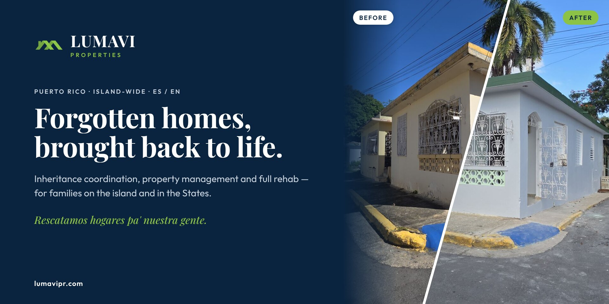
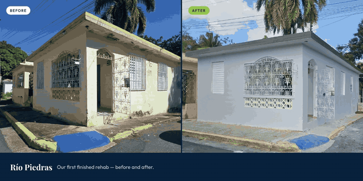
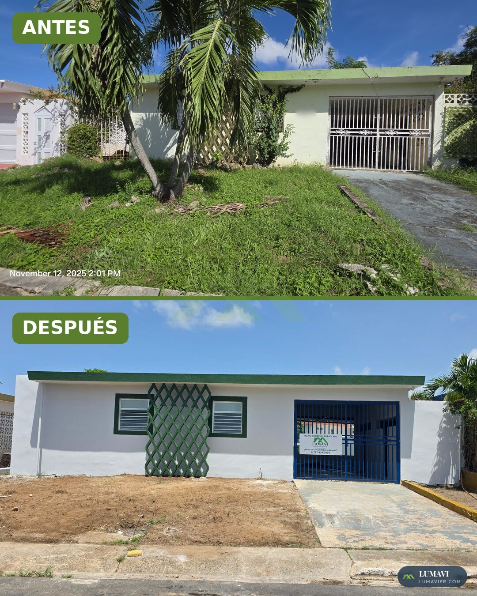
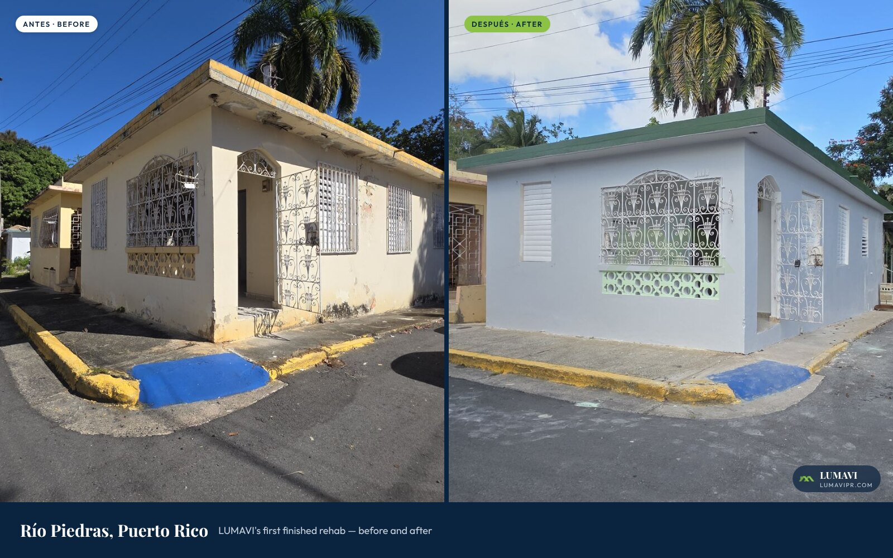
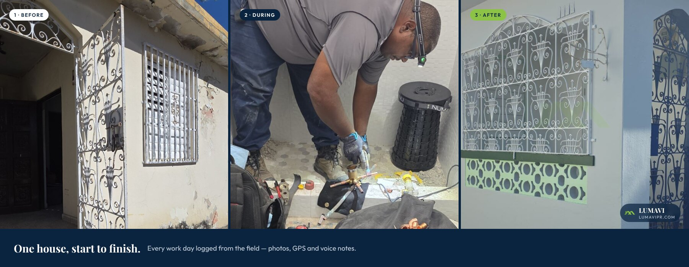
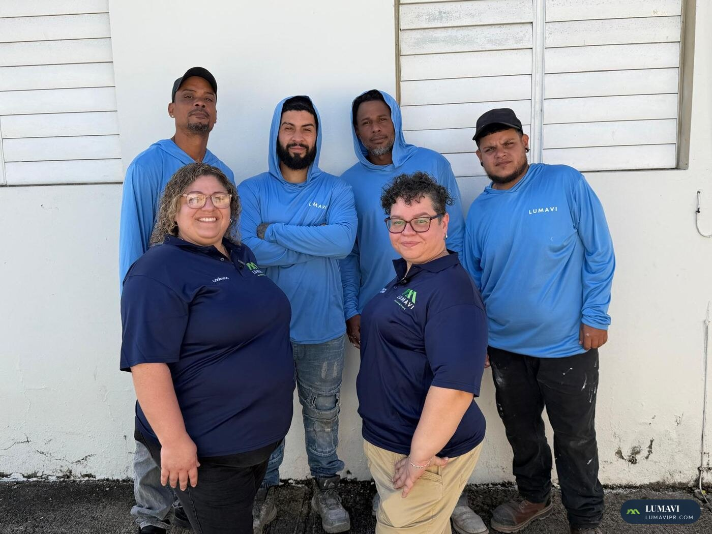
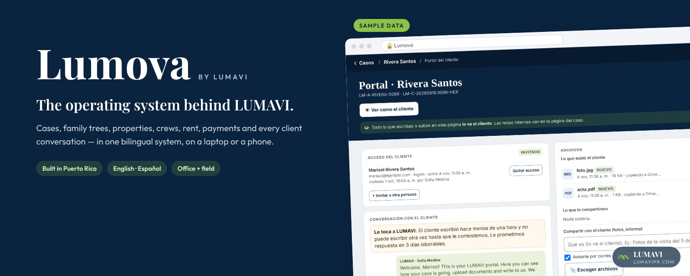
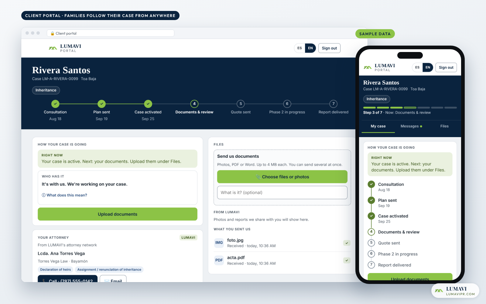
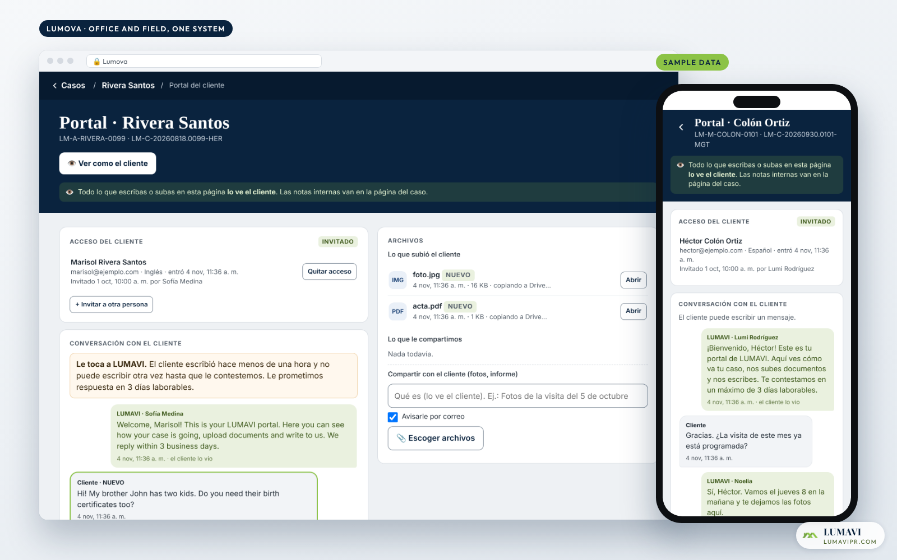
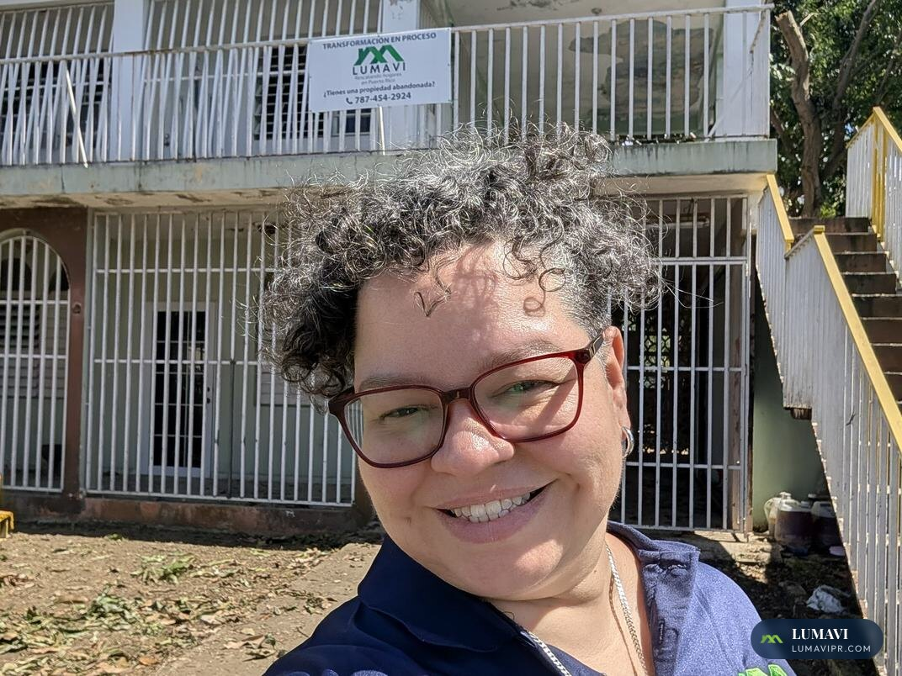

# LUMAVI Properties

## Rescate de propiedades · herencias · administración de propiedades en Puerto Rico

**Le devolvemos la vida a casas olvidadas y heredadas en Puerto Rico — y construimos Lumova, nuestra propia plataforma bilingüe, para manejar cada caso, cada casa y cada brigada.**

[Qué hacemos](#qué-hacemos) · [El trabajo](#el-trabajo) · [Lumova](#lumova--la-plataforma-que-construimos) · [La fundadora](#la-fundadora) · [Contacto](#contacto)

---

 Recorrido rápido · <a href="assets/lumavi-tour.mp4">video completo (MP4)</a> · las pantallas usan datos de ejemplo

---

## Por qué existe LUMAVI

En Puerto Rico hay alrededor de **307,000 viviendas desocupadas**, según datos del Servicio Postal reportados en 2024 ([Metro Puerto Rico](https://www.metro.pr/noticias/2024/11/21/alrededor-de-300-mil-viviendas-en-la-isla-estan-desocupadas/)). Muchas están trancadas en una herencia sin terminar: los herederos viven en Florida, Nueva York o Pensilvania, los papeles nunca empezaron, y la casa se va cayendo poco a poco.

LUMAVI es el equipo aquí para esas familias. Coordinamos la herencia, le echamos el ojo a la casa, la rescatamos y ayudamos a la familia a decidir qué sigue: quedársela, alquilarla o venderla.

> *"Una casa abandonada no es solo una estructura perdida. Es una historia esperando volver a empezar."*
> — Lumier Rodríguez, Fundadora

---

## Qué hacemos

| | Servicio | Para quién |
|---|---|---|
| 🏛️ | **[Coordinación de herencias](https://lumavipr.com/herencia-desde-afuera)** — árbol familiar, documentos, CRIM y Registro, y el abogado o notario con licencia que radica la declaratoria de herederos. | Herederos en la isla **y en Estados Unidos** |
| 👀 | **[Ojos en la Isla](https://lumavipr.com/ojos)** — vamos a la casa y te mandamos fotos y un resumen de cómo está. | Dueños que viven fuera |
| 🔑 | **[Administración y Concierge](https://lumavipr.com/concierge)** — visitas mensuales, contratistas, llaves, facturas y documentos. | Casas vacías, heredadas o alquiladas |
| 🔨 | **Rescate y remodelación** — casas abandonadas que vuelven a la vida, documentadas día a día desde el campo. | Familias y el portafolio de LUMAVI |
| 🏡 | **Alquiler y venta** — casas restauradas por LUMAVI; las ventas de clientes las lista nuestra corredora con licencia, bajo su propia licencia. | Familias buscando hogar |
| 🧭 | **[¿Acabas de comprar desde Estados Unidos?](https://lumavipr.com/acabo-de-comprar)** — los primeros 30 días después del cierre, resueltos. | Dueños nuevos que viven fuera |

**Empieza aquí:** una consulta por video **[desde $25](https://lumavipr.com/consultas)**. Tus hermanos pueden entrar a la misma llamada desde donde estén, y lo que pagas se acredita a cualquier servicio de LUMAVI dentro de 90 días.

LUMAVI no es un bufete y no da consejo legal. Coordinamos, buscamos documentos y verificamos récords en el campo. Toda determinación legal la hace un abogado o notario público con licencia en Puerto Rico. Los costos de terceros se pasan al costo, con recibo, y nunca se les sube el precio. LUMAVI no acepta comisiones por referido y nunca guarda fondos de una herencia ni de una venta.

---

## El trabajo

Casas de verdad, fotos de verdad. La fecha de la cámara se queda a propósito: demuestra que nuestro equipo estuvo ahí.

**Donde empezó todo — Bayamón.** La casa heredada de la familia de la fundadora, cerrada por más de 30 años. Rescatada, remodelada y alquilada otra vez.

**Río Piedras.** La primera remodelación terminada de LUMAVI para la venta.

**Una casa, de principio a fin** — cada día de obra se documenta desde el campo con fotos, GPS y notas de voz.

 La gente que hace el trabajo.

---

## Lumova — la plataforma que construimos

La mayoría de las compañías de propiedades funcionan con llamadas, hojas de cálculo y memoria. Nosotros construimos **Lumova**: un solo sistema, desde cero, aquí en Puerto Rico y para cómo de verdad se mueven las herencias y las propiedades aquí. Hoy maneja LUMAVI de punta a punta. Está hecha para crecer y convertirse en un producto para otros negocios de propiedades en la isla.

**Para las familias** — un sitio bilingüe que se instala como app, y un portal privado donde cada familia ve su caso paso a paso, sube documentos y le escribe al equipo.

**Para el equipo — Lumova** — una sola app para la oficina y el campo: casos, árboles familiares, propiedades, brigadas, renta, facturas y cada conversación con el cliente.

### Lo que hace Lumova

- **El caso a la vista de la familia** — siete pasos claros, quién lo tiene ahora mismo, y el aviso desde la calle (*"Estamos en el CRIM por tu caso"*).
- **El formulario de familia por el teléfono** — las 8 páginas de papel ahora son un formulario guiado, bilingüe, que guarda solo.
- **Árbol familiar** — se dibuja con los datos del caso; se imprime para la abogada y la familia lo ve.
- **Lector de documentos con IA** — lee los papeles que llegan y los archiva para que el equipo los confirme.
- **Cobro con un toque y pago en línea** — el caso sabe cuál pago sigue.
- **La vida de cada propiedad** — interesado → deal → obra → renta → vendida, con la ganancia por propiedad.
- **Herramientas de campo** — reportes de obra con fotos, GPS y notas de voz; gastos; inspecciones para cotizar.
- **Renta** — contratos, pagos y quién está atrasado, de un vistazo.
- **Reloj de respuesta** — mide cuánto espera cada cliente por nosotros, para que nadie se quede olvidado.

| | |
|---|---|
| **Desde junio de 2026** | construida mientras trabajamos casos reales |
| **230+** | pull requests, en pasos pequeños y revisables |
| **100+** | decisiones escritas, cada una con su porqué |
| **50+** | funciones del servidor detrás del sitio, los portales y el campo |
| **30+** | pruebas automáticas |
| **2** | idiomas en cada página para clientes |

Más detalle (en inglés): **[docs/PLATFORM.md](docs/PLATFORM.md)** · **[docs/MILESTONES.md](docs/MILESTONES.md)**

Las pantallas usan datos de ejemplo. Nunca publicamos información de clientes.

---

## La fundadora

**Lumier "Lumi" Rodríguez** — Fundadora y Presidenta

Nacida y criada en Bayamón, con raíces en Comerío. En 1998 se fue a la Florida y pasó a ser parte de la diáspora puertorriqueña: lejos de su tierra, pero sin soltarla nunca.

- **15 años** como **gerente de proyectos y arquitecta de soluciones**, dirigiendo **integraciones de API e implementaciones**
- Inspectora de campo y analista para **servicers hipotecarios nacionales** en el sur de la Florida
- Experiencia en proyectos de construcción, y la arquitecta de **Lumova**, la plataforma de LUMAVI

Con la muerte de su abuela, los trámites de herencia la llevaron a una casa de la familia cerrada por más de treinta años. Su propia familia tenía casas vacías. Ese día entendió que no hacen falta más casas: hace falta recuperar las que ya existen. Así nace LUMAVI.

 

---

## Contacto

| | |
|---|---|
| 🌐 Sitio | [lumavipr.com](https://lumavipr.com/) · [Instala la app](https://lumavipr.com/app) |
| 📞 Teléfono y WhatsApp | [(787) 454-2924](https://wa.me/17874542924) |
| ✉️ Familias y clientes | [casaslumavi@gmail.com](mailto:casaslumavi@gmail.com) |
| 💼 Negocios y aliados | [hola@lumavipr.com](mailto:hola@lumavipr.com) |
| 📍 Dónde trabajamos | Toda la isla — y nuestros clientes, donde sea que vivan |

---

**Rescatamos hogares pa' nuestra gente.**

© 2025–2026 LUMAVI Properties Corp. · Todos los derechos reservados · Fotos y pantallas con marca de agua; no se permite su uso · Lumova construida con <a href="https://www.anthropic.com/claude">Claude</a> de Anthropic

