

<a href="https://lumavipr.com/en/">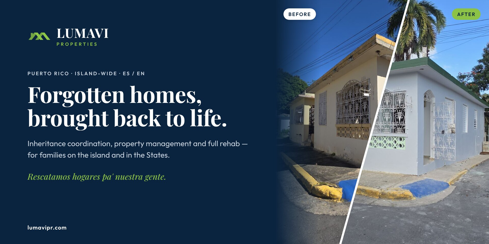</a>

# LUMAVI Properties

## Puerto Rico property rescue · inheritance coordination · property management

**We bring forgotten and inherited homes in Puerto Rico back to life — and we built Lumova, our own bilingual platform, to run every case, every house and every crew.**

[What we do](#what-we-do) · [The work](#the-work) · [Lumova](#lumova--the-platform-we-built) · [The founder](#the-founder) · [Milestones](docs/MILESTONES.md) · [Contact](#contact)

---

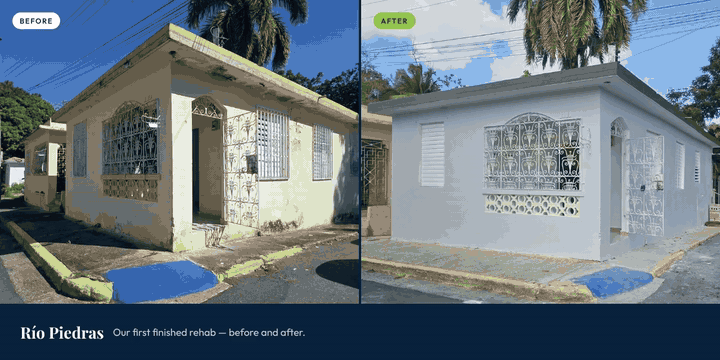
 Quick tour · <a href="assets/lumavi-tour.mp4">full video (MP4)</a> · screens show sample data

---

## Why LUMAVI exists

Puerto Rico has roughly **307,000 vacant homes**, according to U.S. Postal Service data reported in 2024 ([Metro Puerto Rico](https://www.metro.pr/noticias/2024/11/21/alrededor-de-300-mil-viviendas-en-la-isla-estan-desocupadas/)). Many of them are stuck in an unfinished inheritance — the heirs live in Florida, New York or Pennsylvania, the paperwork never started, and the house slowly falls apart.

LUMAVI is the team on the ground for those families. We coordinate the inheritance, look after the house, rescue it, and help the family decide what comes next: keep it, rent it, or sell it.

> *"Una casa abandonada no es solo una estructura perdida. Es una historia esperando volver a empezar."*
> — Lumier Rodríguez, Founder

---

## What we do

| | Service | Who it's for |
|---|---|---|
| 🏛️ | **[Inheritance coordination](https://lumavipr.com/en/inherited-house-puerto-rico)** — family tree, documents, CRIM and Registry records, and the licensed attorney or notary who files the *declaratoria de herederos*. | Heirs on the island **and in the States** |
| 👀 | **[Property checks — *Ojos en la Isla*](https://lumavipr.com/en/property-check)** — we walk the house and send you photos and a written condition summary. | Owners who live off the island |
| 🔑 | **[Property management & concierge](https://lumavipr.com/en/concierge)** — monthly visits, contractor meetings, keys, bills and documents. | Empty, inherited or rented homes |
| 🔨 | **Rescue & rehab** — abandoned houses brought back to life, documented every day from the field. | Families and LUMAVI's own portfolio |
| 🏡 | **Rentals & sales** — LUMAVI's restored homes; client sales are listed by our in-house licensed real estate broker under her own license. | Families looking for a home |
| 🧭 | **[Just bought from the States?](https://lumavipr.com/en/just-bought)** — the first 30 days after closing, handled. | New owners living off-island |

**Start here:** a video consultation **[from $25](https://lumavipr.com/en/consultations)** — siblings can join the same call from anywhere, and the fee is credited toward any LUMAVI service within 90 days.

LUMAVI is not a law firm and does not give legal advice. We coordinate, retrieve documents and verify records in the field. Every legal determination is made by a licensed Puerto Rico attorney or notario público. Third-party costs are passed through at cost with receipts and are never marked up. LUMAVI accepts no referral fees and never holds estate funds or sale proceeds.

---

## The work

Real houses, real photos. We keep the camera's date stamp on purpose — it shows our team was there.

**Where it started — Bayamón.** The founder's own inherited family house, closed for more than 30 years. Rescued, rehabbed, and rented again.

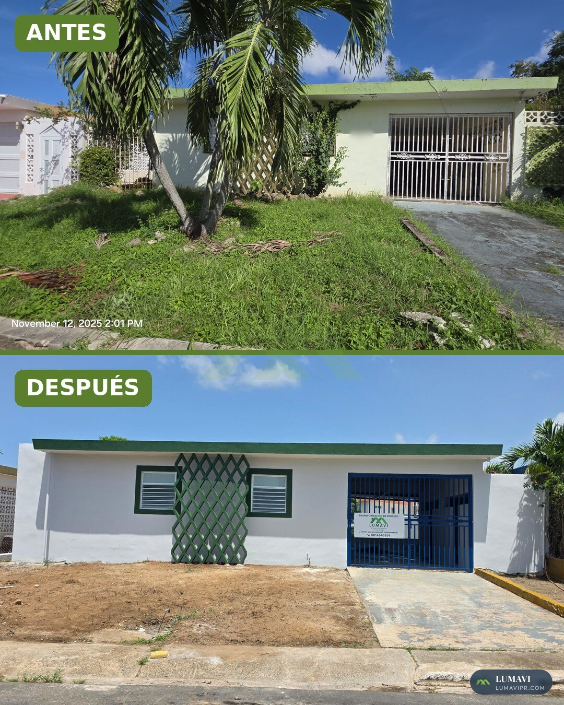

**Río Piedras.** LUMAVI's first finished rehab for sale.

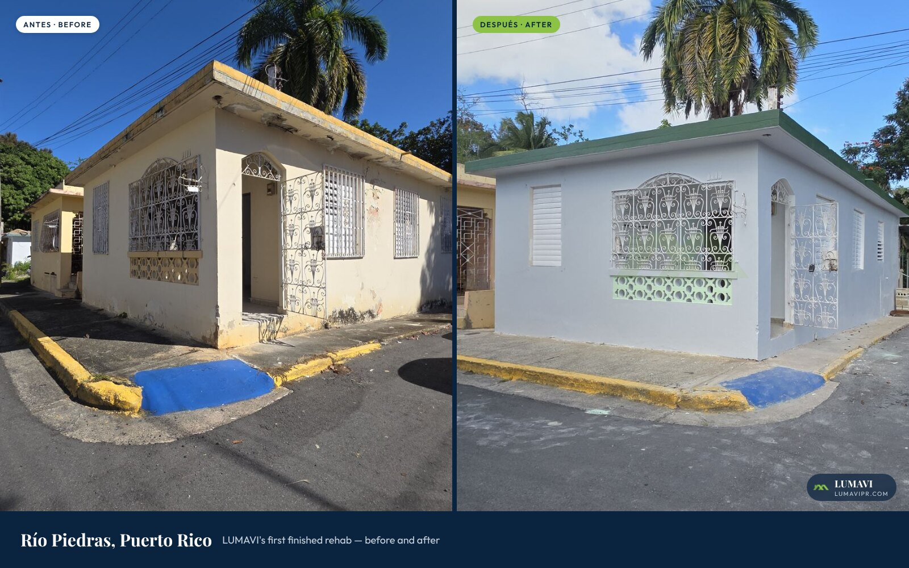

**One house, start to finish** — every work day is logged from the field with photos, GPS and voice notes.

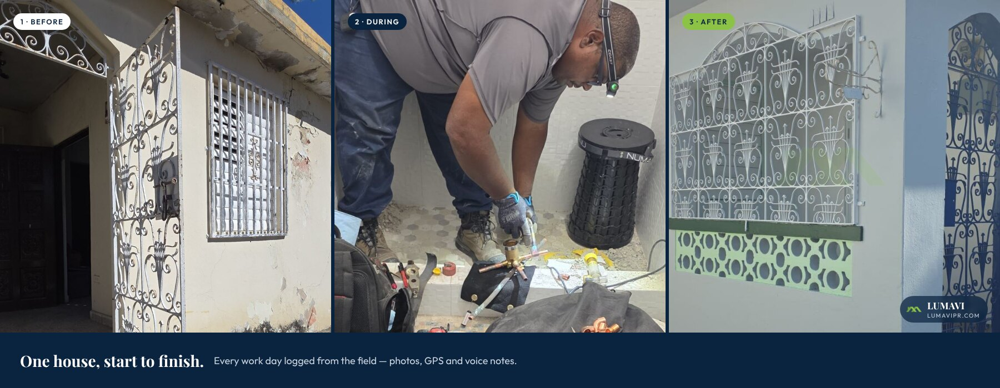

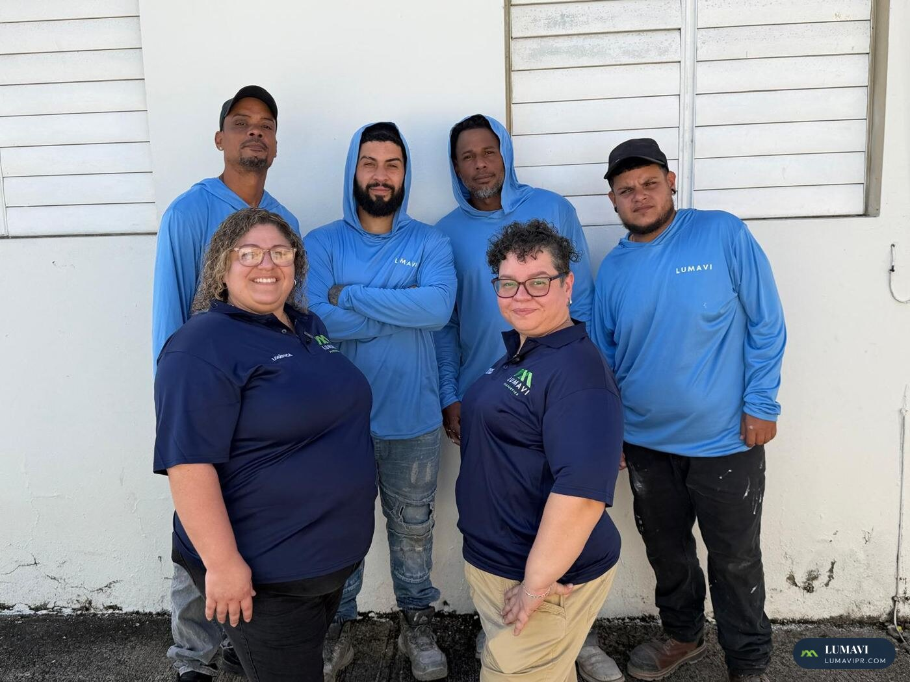 The people who do the work.

---

## Lumova — the platform we built

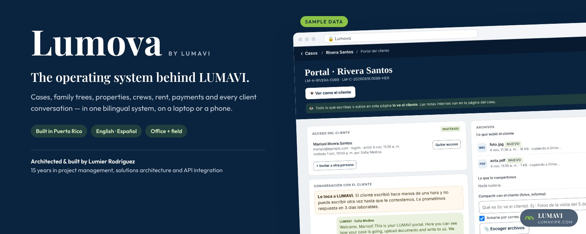

Most property companies run on phone calls, spreadsheets and memory. We built **Lumova** instead — one system, from the ground up, in Puerto Rico, for how inheritance and property work actually happens here. Today it runs LUMAVI end to end. It is built to grow into a product for other property businesses on the island.

**Who built it.** Lumova was architected and built by LUMAVI's founder, **Lumier Rodríguez**, with Claude as her engineering partner. Behind it are **15 years as a project manager and solutions architect** leading API integrations and implementations — plus years in the field inspecting and analyzing properties for national mortgage servicers. She knew the paperwork, the houses and the systems, so she built one tool that handles all three. [About the founder ↓](#the-founder)

**For families** — a bilingual website that installs as an app, and a private portal where each family sees its case step by step, uploads documents and talks to the team.

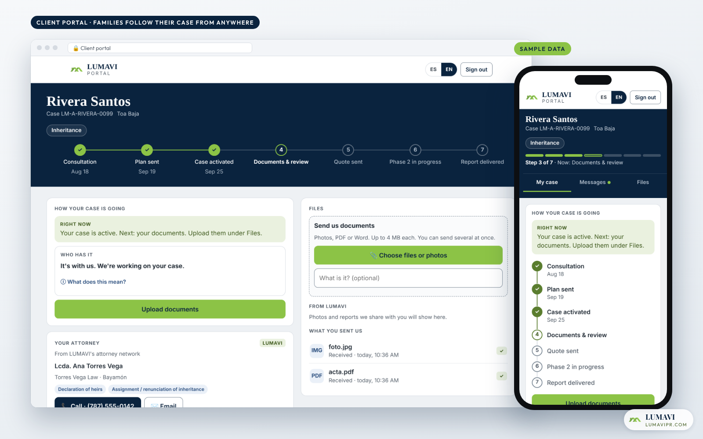

**For the team — Lumova** — one app for the office and the field: cases, family trees, properties, crews, rent, invoices and every client conversation in one place.

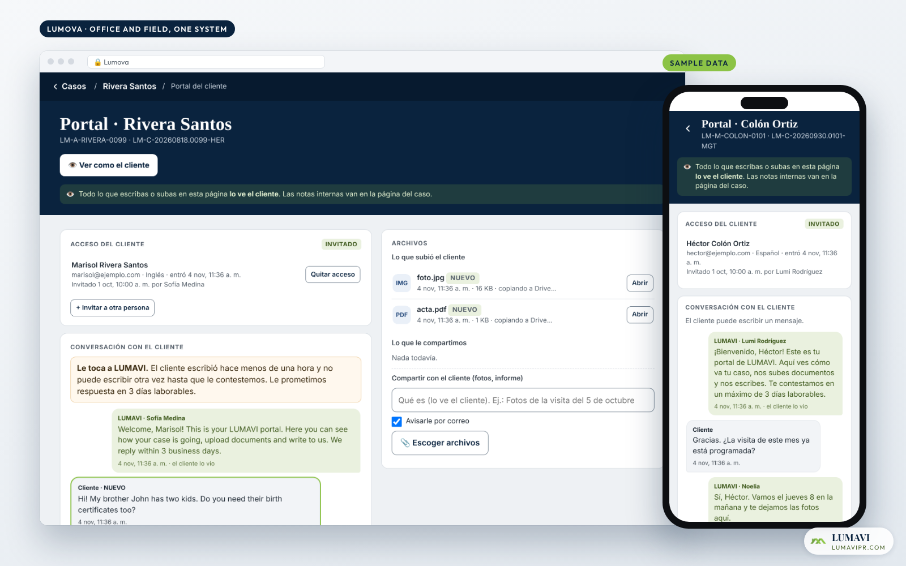

**For everyone else** — the public site, in English and Spanish.

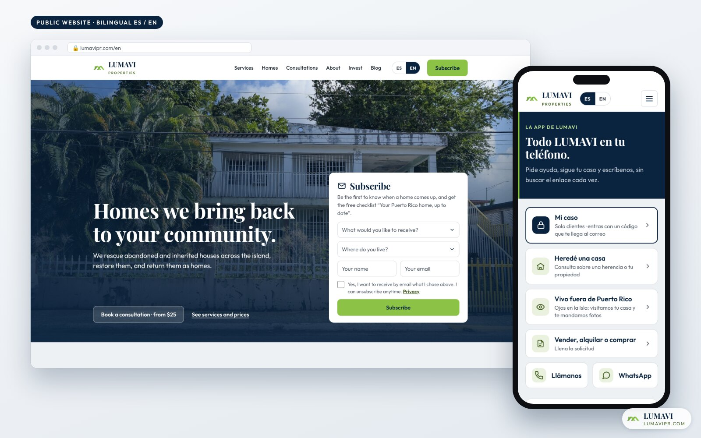

### What Lumova does

- **Case tracking families can see** — seven clear steps, who has the case right now, and a live field check-in (*"We're at the CRIM for your case"*).
- **Family intake by phone** — the old 8-page paper form is now a guided, bilingual, save-as-you-go form.
- **Family trees drawn from the case data** — printable for the attorney, visible to the family.
- **AI document reader** — reads incoming case documents and files them for the team to confirm.
- **One-tap invoicing and online payments** — the case knows which payment comes next.
- **Property lifecycle** — interested → deal → rehab → rent → sold, with profit per property.
- **Field tools** — work reports with photos, GPS and voice notes; expenses; inspections to quote.
- **Rent tracking** — leases, payments and who is late, at a glance.
- **Response-time clock** — measures how long every client waits on us, so nobody gets forgotten.

### By the numbers

| | |
|---|---|
| **Since June 2026** | built and shipped while running real cases |
| **230+** | pull requests — shipped in small, reviewable steps |
| **100+** | written product decisions, each with the reason behind it |
| **50+** | serverless functions behind the website, portals and field tools |
| **30+** | automated test suites |
| **2** | languages on every customer page — English and Spanish |

More about Lumova: **[docs/PLATFORM.md](docs/PLATFORM.md)** · How we got here: **[docs/MILESTONES.md](docs/MILESTONES.md)**

Screens show sample data. No client information is ever published.

---

## The founder

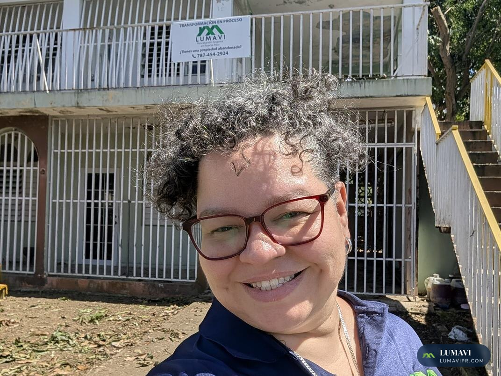

**Lumier "Lumi" Rodríguez** — Founder & President

Born and raised in Bayamón, with roots in Comerío. Moved to Florida in 1998 and became part of the Puerto Rican diaspora — far from the island, but never letting go of it.

**Work background**

- **Project management & solutions architecture — 15 years.** Planning, designing and delivering technology projects from first requirement to go-live.
- **API integration & implementation.** Connecting systems so information flows between them — the same skill that ties Lumova to payments, email, WhatsApp, documents and AI.
- **Property inspection & analysis.** Field inspector and analyst for national mortgage servicers in South Florida — walking, documenting and evaluating properties marked by time and neglect.
- **Construction projects.** Hands-on with rehab work, which shaped how LUMAVI scopes, documents and runs every job.
- **Builder of Lumova.** Architected LUMAVI's own platform and leads every decision behind it.

When her grandmother passed, the inheritance led her to a family house that had been closed for more than thirty years. Her own family had homes sitting empty. That day she understood: *we don't need more houses — we need to recover the ones we already have.* That is how LUMAVI was born.

 

---

## How we work

- **Real photos only** — no stock houses, no AI-generated homes. Date stamps stay.
- **Licensed work stays licensed** — attorneys, notaries, brokers and engineers do what their license covers.
- **No hidden margins** — third-party costs at cost, with receipts. No referral fees.
- **Bilingual by default** — about 80% of our clients live in the States.
- **Everything documented** — every case, every house, every decision.

---

## Contact

| | |
|---|---|
| 🌐 Website | [lumavipr.com](https://lumavipr.com/en/) · [Install the app](https://lumavipr.com/app) |
| 📞 Phone & WhatsApp | [(787) 454-2924](https://wa.me/17874542924) |
| ✉️ Families & clients | [casaslumavi@gmail.com](mailto:casaslumavi@gmail.com) |
| 💼 Business & partners | [hola@lumavipr.com](mailto:hola@lumavipr.com) |
| 📍 Service area | All of Puerto Rico — and our clients wherever they live |

---

**Rescatamos hogares pa' nuestra gente.**

© 2025–2026 LUMAVI Properties Corp. · All rights reserved · Photos and screens are watermarked and may not be reused · Lumova built with <a href="https://www.anthropic.com/claude">Claude</a> by Anthropic

