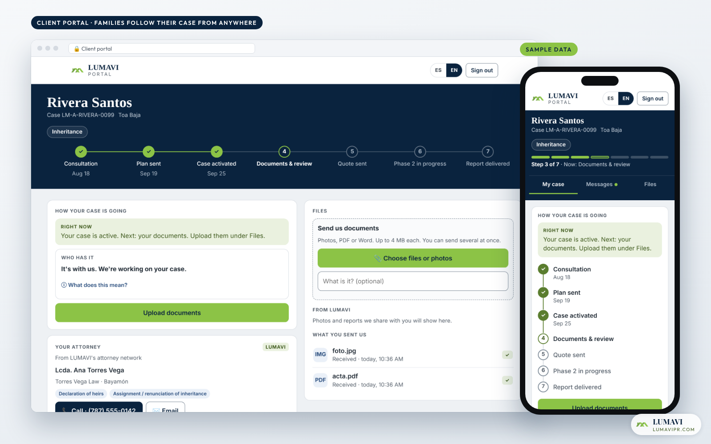

# The LUMAVI platform

How a Puerto Rico property-rescue company runs every inheritance case, every house and every crew from one bilingual system it built itself.

[← Back to the overview](../README.md)

---

## Why we built it

Inheritance work in Puerto Rico is slow, paper-heavy and spread across many offices: the CRIM, the Property Registry, attorneys, notaries, municipalities and courts. Most of our clients live in the States, so they can't walk into an office — or into the house. Off-the-shelf property software doesn't know any of that.

So we designed our own, around three people:

| Who | What they need | What the platform gives them |
|---|---|---|
| **The family** (often in Florida or New York) | To know what's happening without calling every week | A private portal: the case in clear steps, who has it right now, documents, messages, family tree, live field check-ins |
| **The team** (office and field) | One place to work, on a laptop or a phone | Cases, properties, tasks, conversations, crews, rent and invoices — with plain labels and the next step always visible |
| **The founder** | To see the whole business without being the bottleneck | Command center, money board, profit per property, response times and weekly conversion |

---

## What it does

**Families and clients**
- Bilingual website (English and Spanish, each with its own address) that installs as a phone app
- Paid video consultations with online payment and booking
- Client portal with a one-time email code — no passwords to forget
- Case progress in seven steps, "who has it now", and field check-ins (*"We're at the CRIM for your case"*)
- Guided family intake form by phone that saves as you go
- Family tree, visible to the family and printable for the attorney
- Tenant app: report rent and see your payment history

**Team**
- Case workspace: summary, tasks, open questions, blockers, notes and history in one thread
- Every conversation with a person in one place — and answered from there
- AI document reader that files incoming case papers for a person to confirm
- One-tap invoicing: the case knows which payment comes next
- Property pages: phase, tasks, files, lockbox log, rent and expenses
- Field tools: work reports with photos, GPS and voice notes; expenses; inspections to quote
- Plain-language labels and help bubbles, built for staff who work mostly in the field

**Management**
- Command center: what's waiting on the founder, what's overdue, what ran overnight
- Money board and profit per property (received vs. billed)
- Response-time clock: how long every client has waited on us, business days only
- Weekly consultation-to-client conversion

---

## How it's built

| Layer | Choice |
|---|---|
| Front end | Hand-built HTML, CSS and JavaScript — no framework, fast on any phone, installable as an app |
| Back end | Serverless functions on Netlify |
| Sign-in | Staff accounts with roles for the team; one-time email codes for clients |
| Data | Structured operational database, with a planned move to Postgres |
| Payments | Online checkout and invoicing |
| Email & messaging | Transactional email, newsletters and WhatsApp |
| AI | Claude by Anthropic — reads documents, drafts and sorts messages; people stay in charge of decisions |
| Design record | Changes and key screens documented in Figma |

---

## How we build

We run the platform like a product team, not like a side project.

- **Spec first.** Anything with statuses, steps or roles gets a one-card spec the founder approves before a line of code is written.
- **Every decision written down.** 100+ numbered decisions, each with the reason in the founder's own words and what it replaced.
- **Small, reviewable changes.** 230+ pull requests, most of them previewed live before release.
- **A change log for people who don't read code.** Every change is explained in plain Spanish for the team.
- **Tested.** 30+ automated test suites, including a full simulated portal with fake data — the screenshots in this repo come from it.
- **Accessible.** Minimum text sizes, contrast checks and 48-pixel buttons, because many of our clients are 65+.
- **Private by design.** Clients only ever see their own case. Prices are restricted to management. Internal pages are kept out of search and analytics. No client data is ever published.

---

## The numbers (Nov 4, 2026)

| | |
|---|---|
| **Since June 2026** | built while running real cases |
| **230+** | pull requests |
| **100+** | written product decisions |
| **50+** | serverless functions |
| **30+** | automated test suites |
| **2** | languages on every customer page |

Screens show sample data. © 2025–2026 LUMAVI Properties Corp. All rights reserved.
